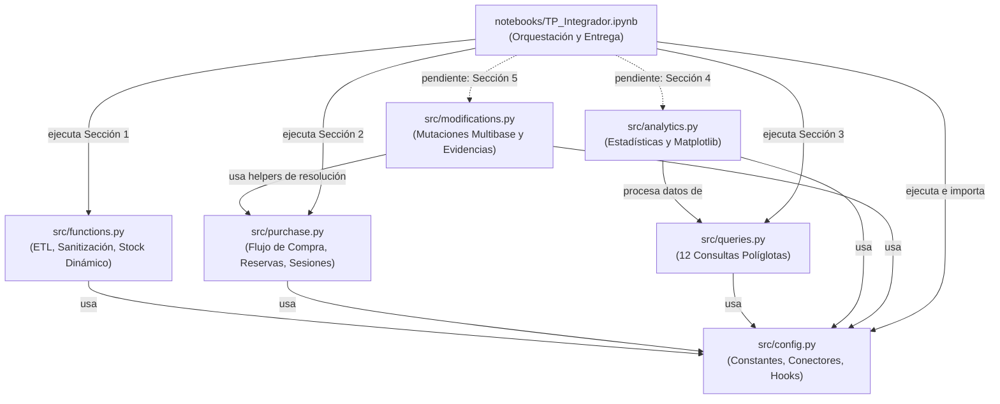

# MODULE_OVERVIEW.md — Panorama Arquitectónico y Modular del Proyecto

> **Materia:** Base de Datos — Licenciatura en Ciencia de Datos en Organizaciones  
> **Institución:** Facultad de Informática / Ciencias Económicas — Universidad Nacional de La Plata (UNLP 2026)  
> **Proyecto:** Sistema de Venta de Entradas y Recomendación de Eventos  
> **Paradigma:** Persistencia Políglota (MongoDB, Neo4j, Redis) con Python 3.11  

---

## 1. Introducción y Propósito del Documento

Este documento proporciona una visión integral y exhaustiva de la arquitectura del software, la distribución de responsabilidades entre módulos del paquete [`src/`](file:///c:/Users/antim/OneDrive/Escritorio/facultad/2d0/2do%20cuatri/base%20de%20datos/trabajo/base_de_datos_trabajo_integrador/src), los contratos de persistencia políglota y su correspondencia directa con los requerimientos establecidos en [`CONSIGNAS.md`](file:///c:/Users/antim/OneDrive/Escritorio/facultad/2d0/2do%20cuatri/base%20de%20datos/trabajo/base_de_datos_trabajo_integrador/CONSIGNAS.md).

El objetivo principal es servir como guía canónica de referencia para desarrolladores, agentes y evaluadores, detallando cómo interactúa cada módulo con los tres motores NoSQL (**MongoDB**, **Neo4j**, **Redis**) para cumplir con las reglas de negocio, los estándares de codificación de [`AGENTS.md`](file:///c:/Users/antim/OneDrive/Escritorio/facultad/2d0/2do%20cuatri/base%20de%20datos/trabajo/base_de_datos_trabajo_integrador/AGENTS.md) y los requerimientos de entrega.

---

## 2. Arquitectura de Persistencia Políglota

El sistema adopta el principio de **utilizar cada motor de base de datos para el propósito en el que sobresale**, evitando la sobrecarga relacional y la duplicación descontrolada.

```
                              ┌──────────────────────────────────────────┐
                              │       Capa de Aplicación / Notebook      │
                              │           (Python 3.11 / Jupyter)        │
                              └──────┬──────────────┬──────────────┬─────┘
                                     │              │              │
                   Entidades & Docs  │   Relaciones │      Estados │
                   Transaccionales   │   Complejas  │    Efímeros  │
                                     ▼              ▼              ▼
                              ┌─────────────┐┌─────────────┐┌─────────────┐
                              │   MongoDB   ││    Neo4j    ││    Redis    │
                              │ (Documental)││   (Grafos)  ││(En Memoria) │
                              └─────────────┘└─────────────┘└─────────────┘
                               • usuarios     • :Usuario    • Sesiones
                               • artistas     • :Artista    • Reservas
                               • lugares      • :Lugar      • Stock real
                               • eventos      • :Evento     • Búsquedas
                               • compras      • :AMIGO_DE   • Caché
                                              • :SIGUE
                                              • :SIMILAR_A
                                              • :PARTICIPA_EN
                                              • :SE_REALIZA_EN
                                              • :COMPRO
```

### 2.1 Matriz de Distribución de Datos y Responsabilidades

| Motor NoSQL | Paradigma | Responsabilidad Primaria | Entidades / Estructuras | Justificación Técnica |
| :--- | :--- | :--- | :--- | :--- |
| **MongoDB** | Documental (BSON) | **Fuente de verdad documental** y transacciones históricas. | Colecciones: `usuarios`, `artistas`, `lugares`, `eventos`, `compras`. | Almacenamiento flexible y semiestructurado de atributos descriptivos sin JOINs costosos. Permite mutaciones de esquemas (ej. servicios de recintos) y agregaciones contables (`$group`, `$lookup`). |
| **Neo4j** | Grafo de Propiedades (LPG) | **Red social musical, navegación y recomendaciones**. | Nodos: `Usuario`, `Artista`, `Lugar`, `Evento`.<br>Relaciones: `:AMIGO_DE`, `:SIGUE`, `:SIMILAR_A`, `:PARTICIPA_EN`, `:SE_REALIZA_EN`, `:COMPRO`. | Optimizado para traversals de grafos en 1, 2 o más saltos (amigos de amigos, artistas similares seguidos por amigos, recomendaciones personalizadas). Índices por etiqueta y restricciones de unicidad sobre IDs. |
| **Redis** | Clave-Valor / En Memoria | **Estados efímeros, control de concurrencia y stock en tiempo real**. | Claves String / JSON: `session:user:<id>`, `reservation:<id>`, `event:<id>:stock`, `event:<id>:capacity`.<br>Sorted Sets: `searches:genre`. | Operaciones atómicas de bajísima latencia (`INCR`, `DECR`, `ZINCRBY`) para prevenir sobreventas (*overbooking*) y soporte nativo de expiración temporal automática (`TTL`) para sesiones (30m) y reservas (10m). |

---

## 3. Inventario y Análisis Exhaustivo de Módulos (`src/`)

```
src/
├── __init__.py           # Declaración del paquete src
├── config.py             # Configuración centralizada, variables de entorno y helpers de conexión
├── functions.py          # Pipeline ETL, normalización, sanitización y cálculo de disponibilidad
├── purchase.py           # Flujo transaccional de compra, reservas temporales y sesiones
├── queries.py            # Consultas políglotas (12 consignas + consultas analíticas auxiliares)
├── analytics.py          # Procesamiento estadístico puro y visualización con Matplotlib
└── modifications.py      # Mutaciones multibase de la Sección 5 y generación de evidencias
```

---

### 3.1 [`config.py`](file:///c:/Users/antim/OneDrive/Escritorio/facultad/2d0/2do%20cuatri/base%20de%20datos/trabajo/base_de_datos_trabajo_integrador/src/config.py) — Configuración Centralizada y Conectores

* **Propósito:** Centralizar todos los parámetros del sistema, credenciales, tiempos de vencimiento, constantes de negocio y utilidades de conexión reutilizables, garantizando la política de **Cero Hardcoding**.
* **Detección Automática de Entorno:**
  * Implementa hooks automáticos en el módulo `socket` (`_patch_socket_for_docker_hosts`) para interceptar peticiones a `mongo`, `neo4j` y `redis`, resolviéndolas transparentemente a `localhost` cuando el código se ejecuta en el host Windows sin requerir configuraciones manuales adicionales.
* **Constantes Clave de Negocio:**
  * `REFERENCE_DATE = "2026-10-01"`: Fecha de corte fija para determinar eventos pasados (asistencia) y futuros (venta y recomendación).
  * `SESSION_TTL_SECONDS = 1800` (30 minutos): Expiración automática de sesiones de usuario en Redis.
  * `RESERVATION_TTL_SECONDS = 600` (10 minutos): Expiración automática de reservas no confirmadas en Redis.
  * `SEARCH_CACHE_TTL_SECONDS = 300` (5 minutos): Tiempo de reutilización de consultas cacheadas.
  * `RELATION_MAPPINGS`: Mapeo explícito de campos relacionales que deben residir en Neo4j y ser sanitizados en MongoDB (`amigos`, `sigue`, `similares`, `artistas`).
  * Parámetros por defecto para la Sección 5: `DEFAULT_PRICE_INCREASE_PERCENTAGE` (10.0%), `DEFAULT_PRICE_INCREASE_CITY` ("Rosario"), `DEFAULT_SERVICE_NAME` ("accesibilidad"), `DEFAULT_CANCEL_EVENT_ID` (7), `DEFAULT_DELETE_USER_NAME` ("Tomás Herrera").
* **Helpers de Conexión:**
  * `get_mongo_client(uri)` / `get_mongo_db(db_name, uri)`: Cliente PyMongo autenticado.
  * `get_neo4j_driver(uri, user, password)`: Driver Bolt para Neo4j con pool de conexiones.
  * `get_redis_client(host, port, password)`: Instancia de `redis.Redis` configurada con `decode_responses=True` para strings legibles.
  * `wait_for_services(seconds)`: Pausa controlada para esperar la inicialización de los contenedores Docker.

---

### 3.2 [`functions.py`](file:///c:/Users/antim/OneDrive/Escritorio/facultad/2d0/2do%20cuatri/base%20de%20datos/trabajo/base_de_datos_trabajo_integrador/src/functions.py) — Pipeline ETL, Ingesta y Sincronización

* **Propósito:** Orquestar el ciclo de vida inicial de los datos: limpieza idempotente, ingestión políglota distribuida, creación de índices/restricciones, sanitización de MongoDB y cálculo de disponibilidad en tiempo real.
* **Pipeline de Ingesta (`process_dataset`):**
  1. `load_raw_dataset(filepath)`: Lee `data/dataset.txt` mediante ejecución aislada en un scope cerrado.
  2. `insert_raw_data_to_mongo(raw_data, db_mongo)`: Vuelca las entidades crudas en colecciones de MongoDB (`usuarios`, `artistas`, `lugares`, `eventos`, `compras`).
  3. `create_mongo_indexes(db_mongo)` y `create_neo4j_constraints(driver_neo4j)`:
     * MongoDB: Índices únicos sobre `usuario_id`, `artista_id`, `lugar_id`, `evento_id` y `compra_id`.
     * Neo4j: Restricciones de unicidad `IS UNIQUE` para los IDs de nodos `Usuario`, `Artista`, `Lugar` y `Evento`.
  4. `populate_neo4j_from_mongo(db_mongo, driver_neo4j)`:
     * Lee MongoDB y ejecuta sentencias Cypher parametrizadas con `UNWIND` y `MERGE`.
     * Construye las relaciones: `:SIMILAR_A` (artistas), `:SE_REALIZA_EN` (eventos $\rightarrow$ lugares), `:PARTICIPA_EN` (artistas $\rightarrow$ eventos), `:AMIGO_DE` (usuarios), `:SIGUE` (usuarios $\rightarrow$ artistas) y `:COMPRO` (usuarios $\rightarrow$ eventos con metadatos de compra).
  5. `sanitize_mongo_collections(db_mongo)`:
     * Aplica `$unset` sobre listas relacionales en MongoDB (`amigos`, `sigue`, `similares`, `artistas`), erradicando duplicaciones innecesarias y garantizando que las relaciones complejas residan exclusivamente en Neo4j.
  6. `populate_redis_initial_state(db_mongo, redis_client)`:
     * Inicializa en Redis las sesiones activas (`session:user:<id>`, TTL 30m) para Sofía Martínez, Juan López y Tomás Herrera.
     * Registra las 2 reservas temporales sin confirmar (Lucía Romero 2 entradas ev 5; Tomás Herrera 3 entradas ev 4) con TTL de 10m.
     * Computa y almacena la capacidad total (`event:<id>:capacity`) y el stock disponible inicial (`event:<id>:stock`).
     * Inicializa el Sorted Set `searches:genre` con las búsquedas históricas (Rock: 7, Electrónica: 5, Folk: 3, Cumbia: 2).
* **Fórmula de Disponibilidad en Tiempo Real (`get_event_available_stock`):**
  $$\text{Disponibles} = \max\left(0, \text{cupo} - \sum \text{compras confirmadas (Mongo)} - \sum \text{reservas vigentes en Redis}\right)$$
  * *Liberación pasiva:* Cuando una reserva expira en Redis tras 10 minutos, su clave se destruye automáticamente; la función no computa esa reserva y el stock se libera inmediatamente sin requerir procesos de fondo (*cron jobs*).

---

### 3.3 [`purchase.py`](file:///c:/Users/antim/OneDrive/Escritorio/facultad/2d0/2do%20cuatri/base%20de%20datos/trabajo/base_de_datos_trabajo_integrador/src/purchase.py) — Flujo Transaccional de Compra y Control de Reservas

* **Propósito:** Implementar el flujo operativo de reserva, confirmación y cancelación de entradas de recitales, garantizando consistencia multibase, concurrencia segura y cumplimiento de las tres reglas de compra.
* **Mecanismos y Funciones Principales:**
  * `resolve_user(db_mongo, user)` / `resolve_event(db_mongo, event)`:
    * Resuelven dinámicamente identificadores numéricos o nombres en MongoDB.
    * Validan que el evento esté en estado `"activo"` (*Fail-Closed*) y que el precio unitario sea estrictamente positivo ($> 0$), mitigando vulnerabilidades de reservas a costo cero.
  * `create_user_session(user, db_mongo, redis_client, session_ttl)`:
    * Genera la clave `session:user:<id>` con TTL de 1800 segundos (30m).
  * `reserve_tickets(user, event, quantity, db_mongo, redis_client, reservation_ttl)`:
    * Valida que el usuario tenga sesión activa (`is_user_session_active`).
    * Verifica stock disponible en Redis (`event:<id>:stock`).
    * Si hay cupo suficiente, decrementa atómicamente el stock en Redis (`decrby`), genera un `reservation_id` atómico (`incr reservation:next_id`) y guarda la reserva con TTL de 10 minutos.
  * `confirm_reservation(reservation_id, db_mongo, driver_neo4j, redis_client)`:
    * Verifica la vigencia de la reserva en Redis. Si expiró, aborta informando el error.
    * Revalida que el evento permanezca activo en MongoDB.
    * Determina el próximo `compra_id` y persiste la compra en MongoDB (`compras`) con el precio vigente al momento de la confirmación (`estado = "confirmada"`).
    * Impacta la relación `:COMPRO` en Neo4j vinculando el nodo `Usuario` y `Evento`.
    * Elimina la clave de reserva en Redis.
  * `cancel_reservation(reservation_id, redis_client)`:
    * Lee la reserva vigente de Redis, restituye el stock atómicamente (`incrby event:<id>:stock`) y elimina la clave de la reserva.
  * `demonstrate_purchase_flow(db_mongo, driver_neo4j, redis_client)`:
    * Suite automatizada que ejecuta y valida los 3 casos obligatorios de las consignas:
      1. Compra exitosa completa (reserva + confirmación).
      2. Intento sin disponibilidad suficiente (rechazo y stock intacto).
      3. Cancelación voluntaria (restitución íntegra de stock).

---

### 3.4 [`queries.py`](file:///c:/Users/antim/OneDrive/Escritorio/facultad/2d0/2do%20cuatri/base%20de%20datos/trabajo/base_de_datos_trabajo_integrador/src/queries.py) — Capa de Consultas Políglotas (Sección 3)

* **Propósito:** Encapsular la ejecución de las 12 consultas del enunciado y exponer helpers genéricos para interactuar con los tres motores NoSQL.
* **Capa Genérica:**
  * `execute_neo4j_query(driver, query, parameters)`: Ejecuta Cypher parametrizado y retorna listas de diccionarios planos.
  * `execute_mongo_aggregation(db, collection_name, pipeline)`: Ejecuta pipelines de agregación BSON.
  * `execute_redis_command(redis_client, command_name, *args)`: Ejecuta comandos nativos de Redis.
* **Mapeo de las 12 Consultas del Trabajo Práctico:**

| # | Función en `queries.py` | Motor | Tipo de Consulta | Regla de Negocio / Detalle |
| :-: | :--- | :---: | :--- | :--- |
| **1** | `get_users_attending_artist_events` | Neo4j | Cypher (`:COMPRO`, `:PARTICIPA_EN`) | Asistencia dinámica: compra confirmada y fecha de evento anterior a `REFERENCE_DATE`. Artista resuelto dinámicamente ("Los Cóndores Eléctricos"). |
| **2** | `get_friends_following_same_artists` | Neo4j | Cypher (`:AMIGO_DE`, `:SIGUE`) | Amigos de Juan López que comparten seguimiento a artistas. Muestra nombre del amigo y del artista. |
| **3** | `recommend_artists_from_friends` | Neo4j | Cypher (Filtro colaborativo social) | Artistas que siguen amigos de Juan López que él no sigue, ordenados descendentemente por cantidad de amigos. |
| **4** | `get_future_events_for_artists` | Neo4j + Redis | Combinada (Grafo + En Memoria) | Eventos futuros de los artistas recomendados (lugar, ciudad, fecha, precio) enriquecidos con `entradas_disponibles` desde Redis. |
| **5** | `get_similar_artists_not_followed` | Neo4j | Cypher (`:SIGUE`, `:SIMILAR_A`) | Filtro basado en contenido: artistas similares a los que sigue Lucía Romero y que ella aún no sigue. |
| **6** | `get_future_events_by_city_and_price` | Neo4j | Cypher (`:SE_REALIZA_EN`) | Eventos futuros en La Plata con precio menor a $40.000 y estado activo. |
| **7** | `count_future_events_by_genre` | MongoDB | `$match`, `$group`, `$project`, `$sort` | Agrupación de eventos activos con fecha $\ge$ `REFERENCE_DATE` por género musical. |
| **8** | `get_total_spent_by_user` | MongoDB | `$match`, `$group`, `$lookup`, `$sort` | Gasto acumulado por usuario en compras confirmadas, ordenado de mayor a menor. |
| **9** | `get_tickets_sold_per_event` | MongoDB | `$lookup` correlacionado + `$project` | Entradas vendidas y total recaudado por evento, preservando eventos con 0 ventas. |
| **10** | `get_online_users` | Redis + Mongo | Scan `session:user:*` + TTL | Usuarios conectados actualmente, TTL restante en segundos y minutos. |
| **11** | `get_active_reservations` | Redis + Mongo | Scan `reservation:*` + TTL | Reservas temporales no expiradas con tiempo restante formateado (mm:ss). |
| **12** | `get_top_searched_genres` | Redis | `ZREVRANGE` sobre `searches:genre` | Top 3 géneros musicales más buscados consultando el Sorted Set en memoria. |

* **Consultas de Apoyo Estadístico (Pendientes para Sección 4):**
  * `get_artist_followers_count(driver)`: Conteo Cypher de seguidores por artista (`(:Usuario)-[:SIGUE]->(:Artista)`).
  * `get_tickets_sold_per_venue(driver)`: Conteo Cypher de entradas vendidas acumuladas por recinto (`(:Lugar)<-[:SE_REALIZA_EN]-(:Evento)<-[:COMPRO]-(:Usuario)`).

---

### 3.5 [`analytics.py`](file:///c:/Users/antim/OneDrive/Escritorio/facultad/2d0/2do%20cuatri/base%20de%20datos/trabajo/base_de_datos_trabajo_integrador/src/analytics.py) — Estadísticas y Visualización Gráfica (Sección 4)

* **Propósito:** Implementar una **arquitectura desacoplada en dos capas** para generar las 4 estadísticas requeridas por las consignas y representarlas con gráficos profesionales en Matplotlib.
* **Capa 1: Procesamiento Estadístico Puro (`build_*_stats`)**
  * `build_artist_followers_stats(raw_records)`: Calcula cantidad de seguidores y participación porcentual (`percentage_share`).
  * `build_event_revenue_stats(raw_records)`: Calcula recaudación acumulada, formateo monetario y participación porcentual.
  * `build_venue_tickets_stats(raw_records)`: Consolida entradas vendidas por recinto con porcentaje del total.
  * `build_genre_searches_stats(raw_records)`: Procesa tuplas del Sorted Set de Redis y computa el volumen relativo de búsquedas.
* **Capa 2: Capa de Visualización con Matplotlib Puro (`plot_*`)**
  * `plot_artist_followers(stats, ax, save_path)`: Gráfico de barras verticales de seguidores por artista.
  * `plot_event_revenue(stats, ax, save_path)`: Gráfico de barras horizontales de recaudación por evento.
  * `plot_tickets_by_venue(stats, ax, save_path)`: Gráfico de barras de entradas por lugar/recinto.
  * `plot_genre_searches(stats, ax, save_path)`: Gráfico de barras de búsquedas por género.
  * `plot_combined_dashboard(...)`: Dashboard ejecutivo 2x2 que renderiza las 4 métricas en una única figura de alta resolución.
* **Tokens de Diseño (`CHART_THEME`):** Paleta moderna Tailwind (Azul `#3B82F6`, Esmeralda `#10B981`, Púrpura `#8B5CF6`, Ámbar `#F59E0B`).

---

### 3.6 [`modifications.py`](file:///c:/Users/antim/OneDrive/Escritorio/facultad/2d0/2do%20cuatri/base%20de%20datos/trabajo/base_de_datos_trabajo_integrador/src/modifications.py) — Mutaciones Multibase y Consistencia (Sección 5)

* **Propósito:** Ejecutar las modificaciones de datos solicitadas en la Sección 5 asegurando la sincronización en todas las bases afectadas y generando consultas de evidencia antes y después de cada cambio.
* **Operaciones Implementadas:**
  * **5.1 Aumento de precio en eventos futuros de una ciudad:**
    * Función: `increase_future_events_price(db_mongo, driver_neo4j, city="Rosario", percentage=10.0)`
    * Impacto: Actualiza `eventos.precio` en MongoDB y `Evento.precio` en Neo4j. Preserva las compras confirmadas históricas según la regla de precios inmutables.
    * Evidencia: `get_city_events_price_evidence(db_mongo, driver_neo4j, city="Rosario")`.
  * **5.2 Adición de servicio a un lugar:**
    * Función: `add_service_to_place(db_mongo, driver_neo4j, place=2, service="accesibilidad")`
    * Impacto: `$addToSet` en MongoDB sobre la lista `servicios` del recinto y actualización opcional del nodo `Lugar` en Neo4j.
    * Evidencia: `get_place_services_evidence(db_mongo, driver_neo4j, place=2)`.
  * **5.3 Cancelación del evento 7:**
    * Función: `cancel_event(event=7, db_mongo, driver_neo4j, redis_client)`
    * Impacto Políglota Integral:
      1. MongoDB: Evento marcado como `"cancelado"`.
      2. MongoDB: Todas sus compras pasan a estado `"reembolsada"`.
      3. Neo4j: Nodo `Evento` pasa a `estado = "cancelado"`.
      4. Neo4j: Aristas `:COMPRO` pasan a `estado = "reembolsada"`.
      5. Redis: Stock y capacidad fijados en 0. Eliminación de todas las reservas temporales vigentes del evento.
      6. Recomendaciones: Excluido de futuros eventos recomendados.
    * Evidencia: `get_cancelled_event_evidence(event=7, db_mongo, driver_neo4j, redis_client)`.
  * **5.4 Eliminación de Tomás Herrera (ID 6):**
    * Función: `delete_user(user=6, db_mongo, driver_neo4j, redis_client, anonymize_purchases=True)`
    * Decisión y Justificación Contable: Las compras históricas **se preservan anonimizadas** (`usuario_id = None`, `usuario_eliminado = True`) en MongoDB para mantener la integridad contable de la productora y no alterar la recaudación real de los recitales.
    * Impacto Políglota:
      1. Redis: Eliminación de sesión activa y cancelación de reservas pendientes restituyendo stock.
      2. Neo4j: Eliminación de relaciones `:AMIGO_DE`, `:SIGUE` y desvinculación o borrado del nodo `Usuario`.
      3. MongoDB: Eliminación del documento en `usuarios`.
    * Evidencia: `get_deleted_user_evidence(user_id=6, db_mongo, driver_neo4j, redis_client)`.
  * **5.5 Eliminación de amistades de un usuario:**
    * Función: `delete_user_friendships(user=2, db_mongo, driver_neo4j)`
    * Impacto: En Neo4j ejecuta `MATCH (u:Usuario {id: $uid})-[r:AMIGO_DE]-(other) DELETE r`. En MongoDB no impacta debido a que la lista `amigos` fue desasociada durante la sanitización inicial.
    * Evidencia: `get_user_friendships_evidence(user=2, driver_neo4j)`.
  * **Suite Global:** `demonstrate_all_modifications(...)` ejecuta las 5 mutaciones imprimiendo las evidencias correspondientes.

---

## 4. Mapa de Interdependencias entre Módulos



---

## 5. Matriz de Correspondencia con CONSIGNAS.md

| Sección de CONSIGNAS.md | Requerimiento Oficial | Componente Implementado | Ubicación en Código | Estado en Notebook |
| :--- | :--- | :--- | :--- | :---: |
| **Requisitos Técnicos** | Limpieza de las tres bases | `clean_db` | `src/functions.py` | `[x] Integrado` |
| **Requisitos Técnicos** | Índices y restricciones de unicidad | `create_mongo_indexes`, `create_neo4j_constraints` | `src/functions.py` | `[x] Integrado` |
| **Requisitos Técnicos** | Evitar duplicación innecesaria | `sanitize_mongo_collections` (`$unset`) | `src/functions.py` | `[x] Integrado` |
| **1. Carga Inicial** | Carga distribuida y estado inicial en Redis | `process_dataset`, `populate_redis_initial_state` | `src/functions.py` | `[x] Integrado` |
| **2. Flujo de Compra** | Sesiones (30m), reservas (10m), confirmación, cancelación | `reserve_tickets`, `confirm_reservation`, `cancel_reservation` | `src/purchase.py` | `[x] Integrado` |
| **2. Flujo de Compra** | Demostración de los 3 casos obligatorios | `demonstrate_purchase_flow` | `src/purchase.py` | `[x] Integrado` |
| **3. Consultas** | 12 Consultas políglotas con nombres y detalles | Consultas 1 a 12 | `src/queries.py` | `[x] Integrado` |
| **4. Estadísticas** | 4 Estadísticas agregadas de negocio | `build_*_stats` | `src/analytics.py` | `[-] Pendiente volcado` |
| **4. Estadísticas** | Gráficos en Matplotlib desde la base | `plot_*`, `plot_combined_dashboard` | `src/analytics.py` | `[-] Pendiente volcado` |
| **5. Modificaciones** | 5.1 Aumento de precios futuros en Rosario | `increase_future_events_price` | `src/modifications.py` | `[-] Pendiente volcado` |
| **5. Modificaciones** | 5.2 Servicio accesibilidad a lugar 2 | `add_service_to_place` | `src/modifications.py` | `[-] Pendiente volcado` |
| **5. Modificaciones** | 5.3 Cancelación evento 7 (reembolsos y cascada) | `cancel_event` | `src/modifications.py` | `[-] Pendiente volcado` |
| **5. Modificaciones** | 5.4 Eliminación usuario 6 (justificación contable) | `delete_user` | `src/modifications.py` | `[-] Pendiente volcado` |
| **5. Modificaciones** | 5.5 Eliminación de amistades | `delete_user_friendships` | `src/modifications.py` | `[-] Pendiente volcado` |
| **5. Modificaciones** | Consultas de evidencia para cada cambio | `get_*_evidence` | `src/modifications.py` | `[-] Pendiente volcado` |
| **6. Informe** | Preguntas conceptuales, arquitectura y diagramas | Markdown / PDF | `notebooks/` / Documento | `[ ] Pendiente redacción` |

---

## 6. Brechas Técnicas Detectadas y Pasos de Sincronización

1. **Consultas de Apoyo Faltantes en [`src/queries.py`](file:///c:/Users/antim/OneDrive/Escritorio/facultad/2d0/2do%20cuatri/base%20de%20datos/trabajo/base_de_datos_trabajo_integrador/src/queries.py):**
   * El módulo [`src/analytics.py`](file:///c:/Users/antim/OneDrive/Escritorio/facultad/2d0/2do%20cuatri/base%20de%20datos/trabajo/base_de_datos_trabajo_integrador/src/analytics.py) cuenta con procesadores y gráficos para *Seguidores por Artista* y *Entradas por Recinto*, pero en `queries.py` aún no existen las funciones específicas de consulta (`get_artist_followers_count` y `get_tickets_sold_per_venue`).
2. **Creación Automática de Carpetas en [`src/analytics.py`](file:///c:/Users/antim/OneDrive/Escritorio/facultad/2d0/2do%20cuatri/base%20de%20datos/trabajo/base_de_datos_trabajo_integrador/src/analytics.py):**
   * Si se pasa un `save_path` hacia un subdirectorio inexistente, `fig.savefig` arroja `FileNotFoundError`. Se requiere incorporar `Path(save_path).parent.mkdir(parents=True, exist_ok=True)`.
3. **Celdas de Ejecución en [`notebooks/TP_Integrador.ipynb`](file:///c:/Users/antim/OneDrive/Escritorio/facultad/2d0/2do%20cuatri/base%20de%20datos/trabajo/base_de_datos_trabajo_integrador/notebooks/TP_Integrador.ipynb):**
   * El notebook actualmente se detiene en la celda de la Consulta 12 (línea 1730). Debe extenderse para incorporar las celdas ejecutables de la **Sección 4** (tablas estadísticas y gráficos Matplotlib) y de la **Sección 5** (las 5 modificaciones con sus respectivas evidencias antes y después).
4. **Redacción del Informe Conceptual (Sección 6):**
   * Responder dentro del notebook o en un documento anexo las preguntas sobre vencimiento de reservas, datos compartidos/desincronización y consistencia al eliminar entidades.
