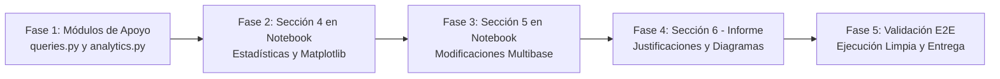

# TASK.md — Plan de Trabajo, Estado de Avance y Auditoría Técnica

> **Materia:** Base de Datos — Licenciatura en Ciencia de Datos en Organizaciones  
> **Institución:** Facultad de Informática / Ciencias Económicas — Universidad Nacional de La Plata (UNLP 2026)  
> **Proyecto:** Sistema de Venta de Entradas y Recomendación de Eventos (Persistencia Políglota)  
> **Referencia Principal:** [CONSIGNAS.md](CONSIGNAS.md) · **Directrices:** [AGENTS.md](AGENTS.md) · **Arquitectura:** [module_overview.md](module_overview.md)  
> **Última actualización:** 15 de Octubre de 2026  

---

## 📋 1. Tablero General de Estado de Avance

| Sección / Requerimiento Oficial | Módulo Principal en `src/` | Estado en Código | Estado en Notebook | Descripción y Cumplimiento |
| :--- | :--- | :---: | :---: | :--- |
| **Requisitos Técnicos: Limpieza** | [`src/functions.py`](src/functions.py) | `[x] Completo` | `[x] Integrado` | Limpieza idempotente (`clean_db`) de MongoDB, Neo4j y Redis. |
| **Requisitos Técnicos: Índices** | [`src/functions.py`](src/functions.py) | `[x] Completo` | `[x] Integrado` | Índices únicos en MongoDB y restricciones `IS UNIQUE` en Neo4j. |
| **Requisitos Técnicos: Cero Duplicación** | [`src/functions.py`](src/functions.py) | `[x] Completo` | `[x] Integrado` | Desasociación de listas relacionales en MongoDB (`$unset`). |
| **1. Carga Inicial y Distribución** | [`src/functions.py`](src/functions.py) | `[x] Completo` | `[x] Integrado` | Pipeline ETL completo: Mongo $\rightarrow$ Neo4j $\rightarrow$ Sanitización $\rightarrow$ Redis. |
| **2. Flujo de Compra y Transacciones** | [`src/purchase.py`](src/purchase.py) | `[x] Completo` | `[x] Integrado` | Sesiones (30m), reservas (10m), confirmación atómica y 3 casos de prueba. |
| **3. Consultas Políglotas (12)** | [`src/queries.py`](src/queries.py) | `[x] Completo` | `[x] Integrado` | 12 consultas con nombres, filtros temporales y ordenamientos correctos. |
| **4. Estadísticas y Gráficos** | [`src/analytics.py`](src/analytics.py) | `[x] Completo` | `[x] Integrado` | Lógica estadística y visualizaciones Matplotlib integradas en el notebook. |
| **5. Modificaciones Multibase** | [`src/modifications.py`](src/modifications.py) | `[x] Completo` | `[x] Integrado` | Mutaciones 5.1 a 5.5 listas con evidencias; volcadas al notebook con ejecuciones. |
| **6. Informe Conceptual** | `notebooks/` / PDF | `[ ] Pendiente` | `[ ] Pendiente` | Justificaciones de diseño, consistencia, TTL y respuestas teóricas obligatorias. |
| **Anexo (Grupos de 3 integrantes)** | Opcional / Pendiente | `[ ] Pendiente` | `[ ] Pendiente` | Reseñas, historial de precios, recomendación de dos saltos y búsquedas de usuario. |

---

## 🎯 2. Plan de Trabajo en Visión General (Fases de Ejecución)

El plan de trabajo estructura las tareas pendientes en fases secuenciales orientadas a cumplir la totalidad de las consignas antes de la fecha límite de entrega (23/10/2026).

---

### 🔹 Fase 1: Finalización de Módulos de Soporte y Correcciones (`src/`)
**Objetivo:** Dejar el 100% de los módulos de `src/` completamente probados, documentados y sin errores de dependencia antes de volcarlos al notebook.

- [x] **Tarea 1.1:** Implementar en [`src/queries.py`](src/queries.py) la consulta Cypher `get_artist_followers_count(driver)` para consultar en Neo4j la cantidad de usuarios que siguen a cada artista (`(:Usuario)-[:SIGUE]->(:Artista)`), ordenados de mayor a menor.
- [x] **Tarea 1.2:** Implementar en [`src/queries.py`](src/queries.py) la consulta `get_tickets_sold_per_venue(driver, db_mongo)` para calcular las entradas vendidas acumuladas por lugar o recinto, cruzando compras con lugares.
- [x] **Tarea 1.3:** Adaptar [`src/analytics.py`](src/analytics.py) para visualización interactiva exclusiva en pantalla/notebook, eliminando `save_path` y la persistencia a disco innecesaria para prevenir `FileNotFoundError`.
- [x] **Tarea 1.4:** Revisar y certificar docstrings en estilo Google y anotaciones de tipo estrictas en [`src/analytics.py`](src/analytics.py) y [`src/queries.py`](src/queries.py).

---

### 🔹 Fase 2: Integración de la Sección 4 en el Notebook (`TP_Integrador.ipynb`)
**Objetivo:** Volcar en celdas de Markdown y código ejecutables las estadísticas analíticas y los gráficos de Matplotlib generados directamente desde las bases de datos.

- [x] **Tarea 2.1:** Encabezado explicativo de la **Sección 4: Estadísticas y Gráficos**, justificando la arquitectura desacoplada en dos capas (cálculo estadístico puro + visualización).
- [x] **Tarea 2.2 — Métrica 4.1:** Celda para *Cantidad de seguidores por artista* (consulta a Neo4j $\rightarrow$ `build_artist_followers_stats` $\rightarrow$ visualización con DataFrame y gráfico de barras verticales).
- [x] **Tarea 2.3 — Métrica 4.2:** Celda para *Recaudación por evento* (consulta a MongoDB $\rightarrow$ `build_event_revenue_stats` $\rightarrow$ visualización con DataFrame y gráfico de barras horizontales formateado en moneda).
- [x] **Tarea 2.4 — Métrica 4.3:** Celda para *Entradas vendidas por lugar* (consulta a Neo4j/Mongo $\rightarrow$ `build_venue_tickets_stats` $\rightarrow$ gráfico de barras).
- [x] **Tarea 2.5 — Métrica 4.4:** Celda para *Cantidad de búsquedas por género* (consulta al Sorted Set en Redis $\rightarrow$ `build_genre_searches_stats` $\rightarrow$ gráfico).
- [x] **Tarea 2.6 — Dashboard Integrado:** Celda opcional que invoque `plot_combined_dashboard` para mostrar un panel unificado 2x2 de alta calidad.

---

### 🔹 Fase 3: Integración de la Sección 5 en el Notebook (`TP_Integrador.ipynb`)
**Objetivo:** Demostrar interactivamente en el notebook las 5 modificaciones multibase exigidas, evidenciando el estado previo y posterior al cambio en cada motor involucrado.

- [x] **Tarea 3.1 — Modificación 5.1:** Aumento del 10% en el precio de eventos futuros en Rosario.
  - Celda de evidencia previa (`get_city_events_price_evidence`).
  - Celda de ejecución (`increase_future_events_price`).
  - Celda de evidencia posterior verificando precios en MongoDB y Neo4j, demostrando que las compras anteriores no cambiaron.
- [x] **Tarea 3.2 — Modificación 5.2:** Agregar servicio `"accesibilidad"` al lugar con ID 2 (Sala Diagonal).
  - Celda de evidencia previa (`get_place_services_evidence`).
  - Celda de ejecución (`add_service_to_place`).
  - Celda de evidencia posterior verificando la lista de servicios.
- [x] **Tarea 3.3 — Modificación 5.3:** Cancelación integral del evento 7 ("Radio Neón Tour").
  - Celda de evidencia previa (`get_cancelled_event_evidence`).
  - Celda de ejecución (`cancel_event`).
  - Celda de evidencia posterior verificando: estado cancelado en Mongo y Neo4j, compras en estado `"reembolsada"`, stock y capacidad en 0 en Redis, reservas destruidas y exclusión en recomendaciones.
- [x] **Tarea 3.4 — Modificación 5.4:** Eliminación del usuario Tomás Herrera (ID 6).
  - Celda de evidencia previa (`get_deleted_user_evidence`).
  - Celda con Markdown justificando la decisión de **anonimizar compras** para resguardar la consistencia contable.
  - Celda de ejecución (`delete_user`).
  - Celda de evidencia posterior demostrando: eliminación en MongoDB, disociación de aristas `:AMIGO_DE` y `:SIGUE` en Neo4j, destrucción de sesión en Redis y preservación de compras con `usuario_id = null`.
- [x] **Tarea 3.5 — Modificación 5.5:** Eliminación de amistades de un usuario a elección (Juan López).
  - Celda de evidencia previa (`get_user_friendships_evidence`).
  - Celda de ejecución (`delete_user_friendships`).
  - Celda de evidencia posterior confirmando 0 relaciones `:AMIGO_DE` para dicho usuario en Neo4j.

---

### 🔹 Fase 4: Redacción del Informe Conceptual (Sección 6)
**Objetivo:** Desarrollar en celdas de Markdown dentro del notebook (o como documento adjunto) las explicaciones técnicas y teóricas exigidas por la cátedra.

- [ ] **Tarea 4.1 — Arquitectura Políglota:** Cuadro/diagrama consolidado de qué se almacena en cada motor y su justificación técnica.
- [ ] **Tarea 4.2 — Integración e Identificadores:** Explicar cómo se integran las bases (IDs canónicos compartidos `usuario_id`, `evento_id`, etc.) y qué consultas combinan más de una base (ej. Consulta 4 que combina Neo4j con Redis, o Consultas 10 y 11 que combinan Redis con MongoDB).
- [ ] **Tarea 4.3 — Respuestas Teóricas Obligatorias:**
  - *Pregunta 1:* ¿Cómo se implementó el vencimiento de reservas? Explicar la eliminación pasiva de Redis por TTL (10m) y cómo la fórmula de disponibilidad libera automáticamente las entradas sin procesos en segundo plano.
  - *Pregunta 2:* ¿Qué datos quedaron en más de una base y cómo se garantiza que no se desincronicen? Explicar el rol de MongoDB como fuente de verdad, Neo4j para la topología de la red y Redis como caché/stock en tiempo real. Explicar las funciones atómicas de actualización en cascada.
  - *Pregunta 3:* ¿Qué problemas de consistencia aparecieron al eliminar datos y cómo se resolvieron? Explicar la eliminación de Tomás Herrera (preservación de compras desvinculadas contablemente vs. borrado en cascada) y la eliminación de amistades en Neo4j sin tocar MongoDB por estar sanitizado.
- [ ] **Tarea 4.4 — Capturas y Salidas:** Asegurar que todas las celdas del notebook conserven sus outputs visibles.

---

### 🔹 Fase 5: Validación End-to-End y Empaquetado para Entrega
**Objetivo:** Certificar la idempotencia, reproducibilidad y empaquetado del proyecto según las pautas de entrega.

- [ ] **Tarea 5.1:** Reiniciar el kernel y ejecutar todas las celdas de principio a fin (*Restart Kernel and Run All Cells*) en un entorno Docker limpio.
- [ ] **Tarea 5.2:** Verificar que no se produzcan excepciones no controladas ni advertencias de deprecación.
- [ ] **Tarea 5.3:** Validar que [`requirements.txt`](requirements.txt) refleje exactamente las versiones compatibles del contenedor.
- [ ] **Tarea 5.4:** Empaquetar el archivo `.zip` de entrega con el notebook ejecutado, el informe y el archivo de requerimientos.

---

## 🔍 3. Registro de Auditoría Técnica y Vulnerabilidades Resueltas

Este registro audita los hallazgos técnicos, vulnerabilidades de negocio y desfasajes de esquemas detectados durante la revisión del código fuente.

### 🔴 Problemas Críticos / Vulnerabilidades de Negocio

- [x] **BUG-01: Estado por defecto permisivo (`"activo"`) en `resolve_event`**
  - **Ubicación:** `src/purchase.py` (`resolve_event`)
  - **Riesgo:** Si un evento carecía del atributo `estado` en MongoDB (borrador, error de carga o `$unset`), el default `"activo"` habilitaba la venta indebida de entradas (*violación del principio Fail-Closed*).
  - **Resolución:** Se configuró `"cancelado"` como estado por defecto (`str(doc.get("estado") or "cancelado")`), bloqueando cualquier venta de eventos incompletos o corruptos.

- [x] **BUG-02: Omisión de verificación de estado del evento en confirmación de compra**
  - **Ubicación:** `src/purchase.py` (`confirm_reservation`)
  - **Riesgo:** Si un evento se cancelaba durante los 10 minutos de una reserva previa, la confirmación procedía sin revalidar el estado vigente en MongoDB.
  - **Resolución:** Se agregó una guarda explícita en `confirm_reservation` que consulta MongoDB y lanza `ValueError` si el evento ya no se encuentra en estado `"activo"`.

- [x] **BUG-03: Precio por defecto en `$0` (*Free Checkout Exploit*)**
  - **Ubicación:** `src/purchase.py` (`resolve_event`, `reserve_tickets`, `confirm_reservation`)
  - **Riesgo:** Con `doc.get("precio", 0)`, si un evento se registraba sin precio o con precio nulo, los usuarios podían reservar y comprar entradas gratis por `$0`, impactando compras por valor cero en MongoDB y relaciones `:COMPRO {total: 0}` en Neo4j.
  - **Resolución:** Se agregaron validaciones estrictas en cascada:
    1. En `resolve_event`: lanza `ValueError` si `precio` no existe o es `<= 0`.
    2. En `reserve_tickets`: valida que `price > 0` antes de reservar cupo.
    3. En `confirm_reservation`: valida que el precio final liquidado sea estrictamente mayor a 0.

### 🟠 Problemas de Integración entre Módulos y Bugs de Ejecución

- [x] **BUG-04: Error de tipeo `tuple_itemb` en `build_genre_searches_stats`**
  - **Ubicación:** `src/analytics.py` (Línea 162)
  - **Riesgo:** Al procesar tuplas crudas de Redis (`zrange/zrevrange(..., withscores=True)`), el bucle definía `tuple_itemb` pero utilizaba `tuple_item`, arrojando un `NameError` inmediato en tiempo de ejecución.
  - **Resolución:** Se corrigió el nombre de la variable en el bucle a `tuple_item`.

- [x] **BUG-05: Desfasaje de claves entre `src/analytics.py` y `src/queries.py`**
  - **Ubicación:** `src/analytics.py` (capa de estadísticas)
  - **Causa:** `analytics.py` se implementó esperando claves en inglés (`event_name`, `total_revenue`, `search_count`), mientras que `queries.py` devuelve campos en español (`evento_nombre`, `total_recaudado`, `cantidad_busquedas`).
  - **Riesgo:** Al pasar la salida de `get_tickets_sold_per_event` o `get_top_searched_genres`, los gráficos generaban recaudación en `$0`, nombres genéricos y conteo de búsquedas en 0.
  - **Resolución:** Se adaptaron las 4 funciones de estadísticas para priorizar los campos en español del modelo de datos de la base.

- [x] **BUG-06: Creación automática de directorios al guardar figuras (`save_path`)**
  - **Ubicación:** `src/analytics.py` (`plot_*`)
  - **Riesgo:** Si el usuario especificaba una ruta hacia un subdirectorio que no existía (ej. `figures/dashboard.png`), `fig.savefig` lanzaba `FileNotFoundError`.
  - **Resolución:** Se eliminó el parámetro `save_path` y la lógica de guardado en disco en favor de renderizado puro en notebook con Matplotlib, descartando el riesgo de `FileNotFoundError`.

- [x] **BUG-07: Faltan 2 consultas en `src/queries.py` para alimentar los gráficos 1 y 3**
  - **Ubicación:** `src/queries.py`
  - **Detalle:** `analytics.py` tiene visualizadores para *Seguidores por artista* y *Entradas por lugar*, pero en `queries.py` no estaban creadas las funciones para extraer esos datos directamente desde Neo4j/MongoDB.
  - **Resolución:** Se implementaron `get_artist_followers_count(driver)` y `get_tickets_sold_per_venue(driver)` utilizando consultas Cypher parametrizadas con `OPTIONAL MATCH`.

- [X] **BUG-08: Desconexión de Secciones 4 y 5 en el Notebook `TP_Integrador.ipynb`**
  - **Ubicación:** `notebooks/TP_Integrador.ipynb`
  - **Detalle:** El notebook actualmente concluye en la celda de la Consulta 12. Faltan las celdas ejecutables de la **Sección 4** (Estadísticas y gráficos con Matplotlib) y de la **Sección 5** (Modificaciones multibase con evidencia).
  - **Acción requerida:** Incorporar las celdas correspondientes consumiendo `src/analytics.py` y `src/modifications.py`.
